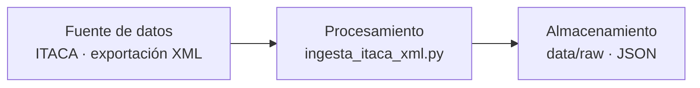
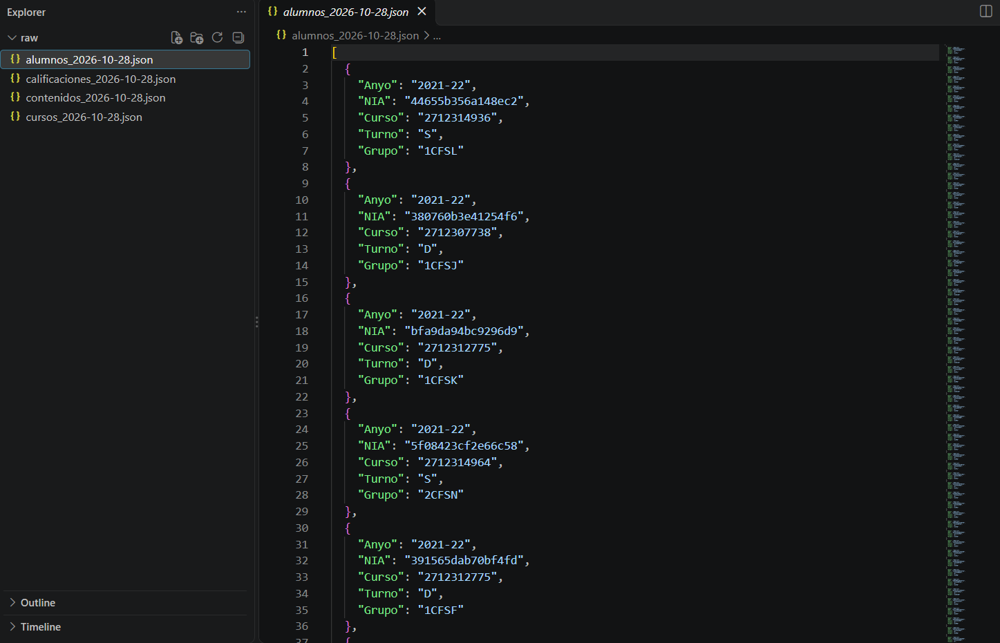

# Proyecto 1 · bigdata-p1-itaca

## Descripción y objetivo

Ingesta batch de las exportaciones XML de ITACA (cursos 2021-2022 a 2025-2026).
El script convierte los XML en JSON normalizados en `data/raw/`, anonimizando
el NIA y descartando cualquier dato identificativo del alumnado.

## Arquitectura



## Estructura del proyecto

```
bigdata-p1-itaca/
├── data/
│   ├── exportaciones/<curso>/*.xml   (entrada, no versionada)
│   └── raw/*.json                    (salida, no versionada)
├── ingesta/
│   ├── ingesta_itaca_xml.py
│   └── validar_raw.py
├── local/capturas/                         (capturas)
├── .gitignore
└── README.md
```

## Fuentes de datos

### Mecanismo de acceso

Cada tabla se obtiene mediante exportación XML desde ITACA. Se genera una
carpeta por curso académico con un XML por tabla.

| Tabla | Mecanismo de acceso (exportación XML) |
|-------|----------------------------------------|
| Alumnos | [procedimiento de exportación en ITACA] |
| Contenidos | [procedimiento de exportación en ITACA] |
| Calificaciones | [procedimiento de exportación en ITACA] |
| Cursos | [procedimiento de exportación en ITACA] |

### Frecuencia de actualización esperada

| Tabla | Frecuencia |
|-------|-----------|
| Alumnos | Anual, al inicio del curso |
| Contenidos | Anual |
| Calificaciones | Por evaluación |
| Cursos | Anual |

## Campos disponibles por tabla

`Anyo` no viene en el XML: se toma del nombre de la carpeta de origen.

### Alumnos (`<alumno>`)

| Campo | Tipo | Descripción |
|-------|------|-------------|
| Anyo | string | Año académico |
| NIA | string | NIA anonimizado (HMAC-SHA256, 16 hex) |
| Curso | string | ID del curso al que pertenece |
| Turno | string | Turno (mañana, tarde, etc.) |
| Grupo | string | Grupo al que pertenece |

### Contenidos (`<contenido>`)

| Campo | Tipo | Descripción |
|-------|------|-------------|
| Anyo | string | Año académico |
| Curso | string | ID del curso al que pertenece |
| Modulo | string | Código del módulo |
| Nombre_Modulo | string | Nombre del módulo (en valenciano) |

### Calificaciones (`<calificacion>`)

| Campo | Tipo | Descripción |
|-------|------|-------------|
| Anyo | string | Año académico |
| NIA | string | NIA anonimizado (mismo hash que en Alumnos) |
| Curso | string | ID del curso |
| Modulo | string | Código del módulo |
| Nota | string | Nota numérica (se convierte a float en la capa siguiente) |
| Evaluacion | string | Evaluación correspondiente (p. ej. `01`) |

### Cursos (`<curso>`)

| Campo | Tipo | Descripción |
|-------|------|-------------|
| Anyo | string | Año académico |
| Codigo | string | Código del curso |
| Nombre_Cas | string | Nombre del curso en castellano |
| Nombre_Val | string | Nombre del curso en valenciano |
| Padre | string | Código del curso padre (jerarquía) |

---

## Bitácora de prácticas

### Bloque 1 · Ingesta batch de ITACA

#### 1. Proceso seguido

1. **Organización de la entrada.** Las exportaciones se colocan en
   `data/exportaciones/<curso>/` (de `2021-2022` a `2025-2026`), un XML por tabla.
2. **Inspección de los XML.** Un script auxiliar mostró qu  e los datos vienen como
   **atributos** (`<alumno NIA="..." curso="..."/>`) y no como elementos hijo, y que
   los registros cuelgan de `<centro><tabla>...`, no directamente de la raíz.
   Esto explicaba que la primera versión (con `findtext`) generase todo `null`.
3. **Mapeo columna ← atributo.** Se definió un `CONFIG` por tabla. Hay
   diferencias de nombre entre tablas (`NIA` en `<alumno>`, `alumno` en
   `<calificacion>`; `Modulo` es `codigo` en contenidos y `contenido` en
   calificaciones).
4. **Recorrido de todos los cursos.** El script itera las carpetas de año y
   concatena los registros, añadiendo `Anyo` desde el nombre de la carpeta.
5. **Anonimización y selección de campos.** Solo se extraen las columnas del
   esquema; el NIA se anonimiza antes de escribir.
6. **Salida.** Un JSON por tabla en `data/raw/<tabla>_<fecha>.json`.
7. **Validación.** `validar_raw.py` comprueba esquema, ausencia de datos
   identificativos e integridad referencial.

#### 2. Ejecución

```bash
export NIA_SECRET="clave-larga-y-secreta"
python ingesta/ingesta_itaca_xml.py
python ingesta/validar_raw.py
```

#### 3. Capturas del resultado

**Ficheros JSON generados por el script:**




#### 4. Decisiones tomadas

**Anonimización del NIA**

- El XML de alumnos contiene nombre, apellidos, documento, fecha de nacimiento,
  teléfonos, emails y dirección. **No se extrae ninguno**: el esquema solo incluye
  los campos necesarios para el análisis.
- El NIA se sustituye por `HMAC-SHA256(NIA, clave)` truncado a 16 caracteres hex.
- Se eligió HMAC con clave secreta en lugar de un hash simple porque los NIA son
  numéricos y un SHA-256 sin clave se revertiría por fuerza bruta en segundos.
- El hash es **determinista**: el mismo NIA y la misma clave dan siempre el mismo
  valor, por lo que los joins Alumnos ↔ Calificaciones siguen funcionando.
- La clave se lee de la variable de entorno `NIA_SECRET`; no está en el código ni
  en el repositorio. Debe conservarse: si cambia, los NIA de cargas distintas no
  coincidirán.
- El log no imprime registros individuales para no volcar datos personales.

**Otras decisiones**

| Decisión | Motivo |
|----------|--------|
| `raw` guarda los IDs tal cual vienen (sin traducir cursos ni módulos) | Mantener `raw` fiel al origen; los nombres se obtienen con joins en la capa siguiente |
| `Anyo` se obtiene de la carpeta | El XML solo trae el año de inicio (`curso="2021"`) |
| `Nombre_Modulo` ← `nombre_val` | Se usa la versión en valenciano; cambiar a `nombre_cas` si se prefiere |
| `Nota` se guarda como string | No se transforman tipos en `raw` |
| Rutas con `Path(__file__)` | El script funciona desde cualquier directorio de ejecución |
| `data/` y `.env` en `.gitignore` | No versionar datos ni secretos |
