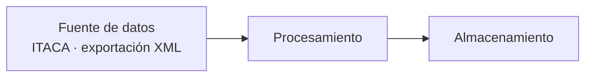

# Proyecto 1 · bigdata-p1-itaca

## Descripción y objetivo

Levantamiento del proyecto mediante docker compose y uso de git para la publicación del mismo.

## Arquitectura

## Fuentes de datos

### Mecanismo de acceso

Cada tabla se obtiene mediante exportación XML:

| Tabla | Mecanismo de acceso (exportación XML) |
|-------|----------------------------------------|
| Alumnos | [procedimiento de exportación] |
| Contenidos | [procedimiento de exportación] |
| Calificaciones | [procedimiento de exportación] |
| Cursos | [procedimiento de exportación] |

### Frecuencia de actualización esperada

| Tabla | Frecuencia |
|-------|-----------|
| Alumnos | [p. ej. anual, al inicio del curso] |
| Contenidos | [p. ej. anual] |
| Calificaciones | [p. ej. por evaluación] |
| Cursos | [p. ej. anual] |

## Campos disponibles por tabla

### Alumnos

| Campo | Tipo | Descripción |
|-------|------|-------------|
| Anyo | string | Año académico |
| NIA | int | Número de Identificación Alumno |
| Curso | string | Curso al que pertenece |
| PrimSeg | string | Primaria o Secundaria |
| Ciclo | string | Ciclo formativo |
| Grado | string | Grado académico |
| Familia | string | Familia profesional |
| Turno | string | Turno (mañana, tarde, etc.) |
| Grupo | string | Grupo al que pertenece |

### Contenidos

| Campo | Tipo | Descripción |
|-------|------|-------------|
| Anyo | string | Año académico |
| Curso | string | Curso al que pertenece |
| Modulo | string | Código del módulo |
| Nombre_Modulo | string | Nombre del módulo |

### Calificaciones

| Campo | Tipo | Descripción |
|-------|------|-------------|
| Anyo | string | Año académico |
| NIA | int | Número de Identificación Alumno |
| Curso | string | Curso al que pertenece |
| Modulo | string | Código del módulo |
| Nota | float | Nota obtenida |
| Evaluacion | string | Evaluación correspondiente |

### Cursos

| Campo | Tipo | Descripción |
|-------|------|-------------|
| Anyo | string | Año académico |
| Codigo | string | Código del curso |
| Nombre_Cas | string | Nombre del curso en castellano |
| Nombre_Val | string | Nombre del curso en valenciano |
| Padre | string | Código del curso padre (jerarquía) |